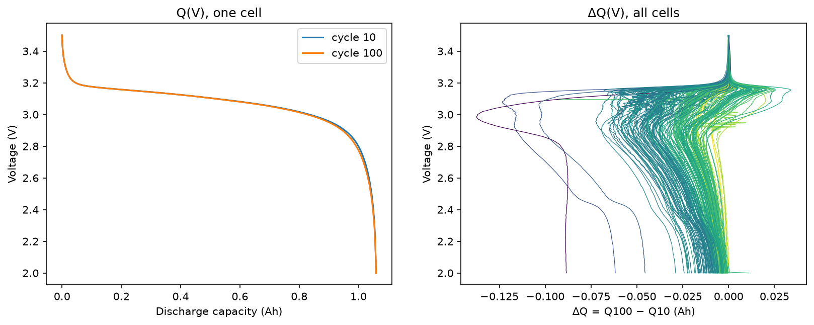
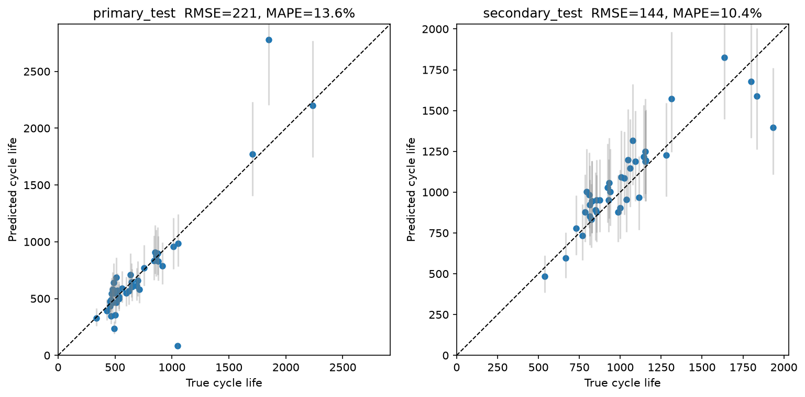
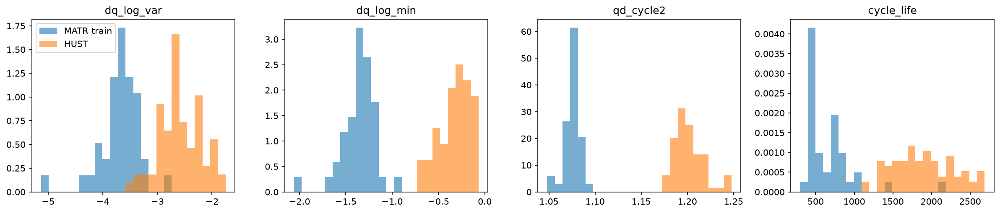

# Battery cycle-life prediction from early cycles

Predicts how many cycles a lithium-ion cell will last using only its first 100 cycles. On the two held-out test sets of the MIT–Stanford–Toyota dataset, the final model has 13.6% and 10.4% mean absolute percentage error, and it gives conformal 90% prediction intervals with 83% and 95% empirical coverage.

## Results

Dataset: MATR (Severson et al., 2019), 124 A123 LFP/graphite cells, using the published cell-level split (41 train, 42 primary test, 40 secondary test). Errors are in cycles (RMSE) and percent (MAPE).

| Model | RMSE primary | RMSE secondary | MAPE primary | MAPE secondary |
|---|---:|---:|---:|---:|
| Mean baseline | 388.8 | 469.9 | 31.9 | 31.2 |
| Elastic net, variance feature | 136.6 | 211.4 | 15.4 | 11.9 |
| Elastic net, discharge features (final) | 221.2 | 143.9 | 13.6 | 10.4 |
| Elastic net, full features | 136.0 | 261.5 | 10.3 | 15.3 |
| LightGBM, full features (tuned) | 215.9 | 350.4 | 13.2 | 17.1 |
| 1D CNN on ΔQ(V) curves, 5-seed ensemble | 318.5 | 373.3 | 15.0 | 21.0 |
| BatteryML benchmark: mean baseline | 398 | 510 | | |
| BatteryML benchmark: variance model | 136 | 211 | | |
| BatteryML benchmark: XGBoost | 334 | 799 | | |

The variance model reproduces the published benchmark, which was a useful check that the data pipeline and the end-of-life rule are right. The final model was picked by leave-one-out CV on the training cells (CV RMSE 110.9), not by test score. The "full" model happens to do better on the primary set but much worse on the secondary set, so I kept the CV choice.

## Why early prediction

Cycling a cell until it dies takes months. Knowing its lifetime after about 100 cycles (roughly a week of testing) speeds up cell qualification and the search for good fast-charging protocols, and the same idea applies to warranty estimates and grading used cells for second-life use.

## Approach



Total capacity hardly moves during the first 100 cycles, but the shape of the discharge curve does. The difference between the cycle-100 and cycle-10 discharge curves, ΔQ(V), is clearly ordered by lifetime (right panel, darker = shorter life). The log variance of ΔQ(V) alone has r = −0.87 with log cycle life, while capacity at cycle 100 has r = 0.18.

Pipeline:

1. `scripts/build_cache.py` turns BatteryML's per-cell files into a small cache (capacity, IR, temperature per cycle and the first 100 Q(V) curves)
2. `src/features.py` computes ΔQ(V) statistics, capacity-fade and charging/thermal features from cycles 1 to 100 only
3. `src/models.py` fits elastic net and LightGBM on log10(cycle life), with scaling inside the pipeline. `src/cnn.py` is a small 1D CNN that reads the curves directly
4. `conformal_intervals` in `src/models.py` gives leave-one-out conformal intervals in log space
5. `scripts/train_final.py` saves the final model for the demo in `app.py`

## Findings

How many cycles are needed (final model, MAPE %):

| Cycles used | 20 | 40 | 60 | 80 | 100 |
|---|---|---|---|---|---|
| Primary test | 24.0 | 15.3 | 137.8 | 16.9 | 13.6 |
| Secondary test | 41.9 | 20.4 | 14.0 | 12.3 | 10.4 |

On the secondary set, 60 cycles is within about 4 points of 100. The 137.8% on the primary set at 60 cycles is one cell (b1c0): its ΔQ at cycle 60 is nearly all positive, so `log|min ΔQ|` falls far outside the training range and the model extrapolates. Without that cell it is 13.4%.

Prediction intervals: 90% conformal intervals cover 83% of primary and 95% of secondary test cells, with median widths of 272 and 465 cycles.



Error analysis: errors don't trend with lifetime (Spearman 0.03) and no batch is systematically off. The worst cell, b1c41 (−92%), has a single bad sample in its cycle-10 discharge curve. Median-filtering the curves and clipping features to the training range would bring the primary RMSE from 221 to 157, but I found that by looking at test cells, so it isn't used for the reported numbers.

Cross-dataset test (MATR to HUST): [HUST](https://doi.org/10.1039/D2EE01676A) uses the same cell type but varies the discharge protocol instead of the charging protocol.

| HUST cells added to training | 0 | 5 | 10 | 20 |
|---|---|---|---|---|
| MAPE on the other HUST cells | 84.4% | 28.3 ± 4.6% | 25.2 ± 2.9% | 22.6 ± 3.7% |

Trained on MATR only, the model under-predicts almost every HUST cell and its intervals cover none of them. Nearly all HUST cells are outside the MATR training range on most features. HUST's high-rate discharges change ΔQ in a way that looks like damage to a MATR-trained model, while HUST cells actually live 2 to 3 times longer. A handful of HUST cells in training fixes most of it.



What didn't work: LightGBM (CV RMSE 229 vs 111) and the CNN (single seeds 323 ± 37 RMSE on the primary set) both lose to the linear model. With 41 training cells, trees can't extrapolate past the training labels and the CNN doesn't have enough data. The CNN's saliency is spread across the whole voltage window rather than focusing where ΔQ separates short and long-lived cells.

## How the evaluation is kept honest

- split by cell using the published split, never by cycle
- features only use cycles up to 100; the label is the first cycle where median-filtered capacity reaches 0.88 Ah
- scalers are fit inside the pipeline on training cells
- model choices are made with leave-one-out CV on training cells; test sets are only used for reporting
- the CNN is reported as an ensemble together with the single-seed spread
- interval coverage is checked on both test sets and on HUST

## Limitations

- one cell type and only 41 training cells in the main results
- needs clean full discharges at cycles 10 and 100, which a real BMS rarely sees
- no partial-cycle features; temperature is close to constant in this dataset
- HUST lifetimes use the dataset's own end-of-test label (about 0.90 Ah by integrated capacity rather than 0.88 Ah), see `src/hust.py`

## Reproducing

Two conda environments are used because BatteryML needs NumPy 1.x.

```bash
conda create -n batteryml python=3.11 -y
conda create -n rul python=3.11 -y
conda activate rul
pip install -r requirements.txt
```

```bash
# BatteryML (github.com/microsoft/BatteryML), installed into the batteryml env
conda activate batteryml
batteryml download MATR data/raw/MATR
batteryml preprocess MATR data/raw/MATR data/processed/MATR
```

```bash
conda activate rul
python -m scripts.build_cache
```

Then run the notebooks in order. Notebook 07 needs `data/raw/HUST/hust_data.zip` from Mendeley Data (dataset `nsc7hnsg4s`).

```bash
python -m scripts.train_final
streamlit run app.py
```

## Layout

```
src/        config, data, splits, features, models, cnn, evaluate, hust
scripts/    build_cache.py, train_final.py
notebooks/  01_explore, 02_features, 03_models, 04_cnn, 05_uncertainty, 06_analysis, 07_transfer
reports/    results_table.csv and figures
app.py      Streamlit demo
```

## References

- Severson et al., "Data-driven prediction of battery cycle life before capacity degradation", Nature Energy 4, 383–391 (2019)
- Attia et al., "Closed-loop optimization of fast-charging protocols for batteries with machine learning", Nature 578, 397–402 (2020)
- Ma et al., "Real-time personalized health status prediction of lithium-ion batteries using deep transfer learning", Energy & Environmental Science (2022)
- Zhang et al., "BatteryML: An open-source platform for machine learning on battery degradation", ICLR 2024
- Angelopoulos and Bates, "A gentle introduction to conformal prediction and distribution-free uncertainty quantification", arXiv:2107.07511
